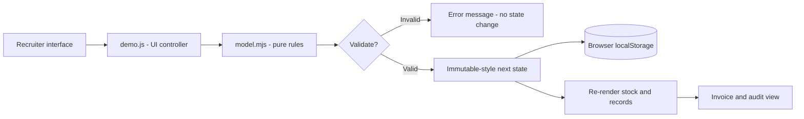

# Alberth — Recruiter Edition

A separate, fast-to-review developer portfolio within the existing static `alberth` repository. Intended for recruiter screening and technical interviews. It does **not** replace the creative/research website.

**Verified live (Vercel):** https://alberth-portfolio-one.vercel.app/hire/  
**Verified demo page (Vercel):** https://alberth-portfolio-one.vercel.app/hire/demo/

The same source repository may also be hosted on GitHub Pages; check the deployment status before sharing those alternative URLs.

## Why this version exists

The original portfolio is animation-heavy and covers many interests. A technical interviewer needs a direct path to a working feature, readable implementation, tests, failure handling, and limitations. The recruiter landing page therefore includes:

- Three honest role lenses (frontend, full-stack intern, creative developer).
- Filters across five work samples.
- A runnable browser transaction lab with code links.
- Explicit limitations and a direct link to engineering checklist.
- Responsive navigation, keyboard-accessible controls and semantic markup.

## Transaction Lab — technical breakdown

A functional browser-only sales order simulator with four seeded products. **It is not a full-stack app.** No API or server-side database; state is stored in the visitor's own localStorage. The independent PostgreSQL-backed Engineering Lab prototype is a different project with separate deployment/testing status.



**Domain functions:**

- `priceOrder`: prevents duplicate items, zero/negative/fractional quantities and overselling; calculates totals.
- `createOrder`: checks the basket and customer, creates an order, deducts inventory without mutating the input state, adds audit records.
- `createInvoice`: links to an existing order and is idempotent for repeat clicks.
- `hydrateState`: handles malformed storage with a safe reset; not a security boundary.

**Trade-offs:** The local state is not multi-user or tamper-proof; transactions across simultaneous browsers cannot be made consistent. There is no authentication, server logging, real payment handling, real customer data, legal invoice output, or persistent backend. Those capabilities belong in a production backend, not a public client-side demo.

## Run locally

```bash
git clone https://github.com/farrellalberth-hue/alberth.git
cd alberth
python -m http.server 8000
```

Open `http://localhost:8000/hire/` and `http://localhost:8000/hire/demo/`. `localhost` is recommended because JavaScript modules and browser storage do not work reliably when opening the HTML from `file://`.

## Tests

Uses the built-in Node.js test runner, with **no npm installation**:

```bash
node --check hire/app.js
node --check hire/demo/demo.js
node --check hire/demo/model.mjs
node --test hire/tests/*.test.mjs
```

GitHub Actions runs the same commands on push/PR that modify the `hire/` directory. This verifies business rules, basic structure and JavaScript syntax. It **does not** replace cross-browser end-to-end, backend security or Lighthouse audits.

## Review in 60 seconds

1. Enter customer name `Demo Customer`, select `Mechanical Keyboard`, quantity 2, and add it.
2. Create order; verify initial stock 18 becomes 16.
3. In **Sales orders**, generate an invoice and open it again: there must still be one invoice.
4. View **Event log**; expect order creation, stock deduction and invoice events.
5. Try ordering 19 keyboards in a fresh session: insufficient stock must prevent submission.
6. Open `demo/model.mjs` and `tests/model.test.mjs`; explain which rules you would move to an API/backend for real production.

## Professional disclosure

Parts of this iteration were created with AI assistance. Generated code, working mockups, and passing automated tests are evidence of a working artifact, **not** of independent authorship or interview-ready knowledge. The developer should inspect each function, explain the architecture, reproduce tests and be able to modify the application without relying entirely on AI-generated output.